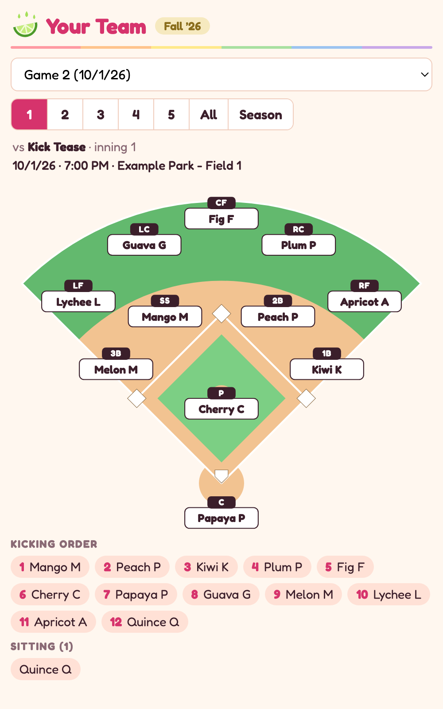
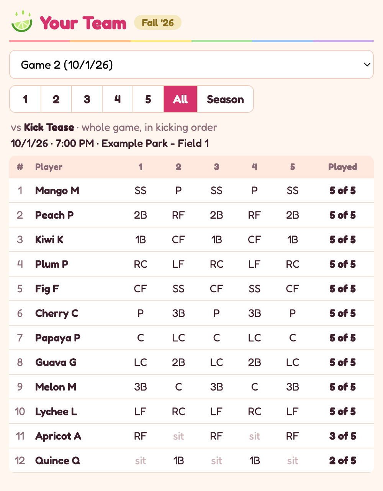
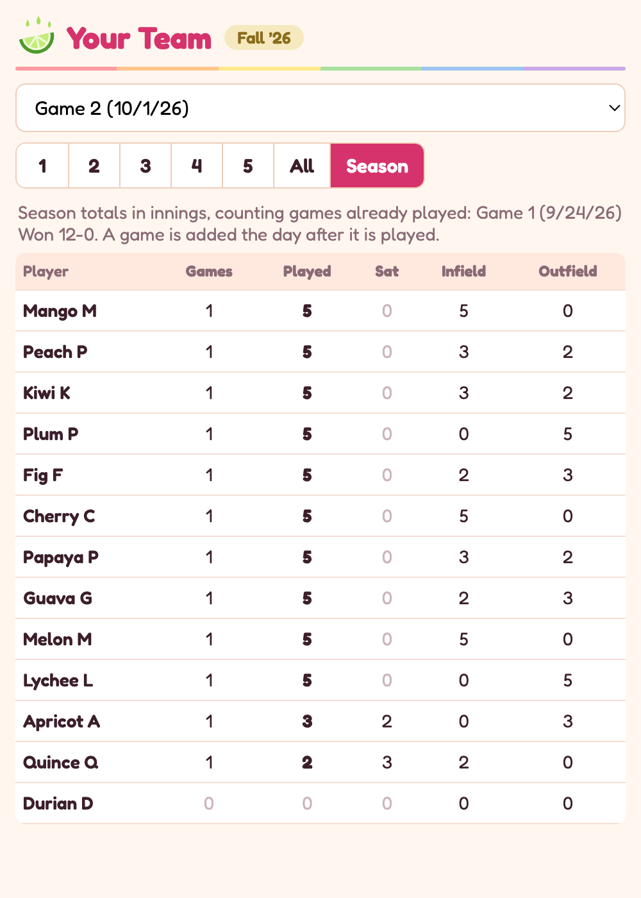

# Kickball Field View

A lineup page for a kickball team. The captain keeps the lineup in a Google Sheet, and players open one link on their phone to see who plays where in each inning, the kicking order, a whole-game table and season totals. Captains and co-captains can also edit the lineup from the same page. There is nothing to install.

Screenshots use made-up players.

| Field | Whole game | Season |
| --- | --- | --- |
|  |  |  |

## Features

- Pick a game and an inning to see who plays each of the 11 positions
- Open or double-booked positions are flagged in red, and so is an absent player who still has a position
- Game date, time, location, opponent and final score
- Kicking order and the players sitting each inning
- Whole-game table with innings played per player
- Season totals: innings played, sat, infield and outfield, across games already played
- Refreshes every 10 seconds while open, so edits in the sheet show up on their own
- Shows load and update errors in a red box at the top, retries a failed first load on its own, and keeps the last good lineup on the device
- Captain tools: move players, reorder the kicking order, record RSVPs, add players from the roster and start the next game, all from the team page

## Set up a team

1. Open the setup page (`start.html` on the site) and choose **Sign in with Google**.
2. Enter your team name and season, then choose **Create my team sheet**. To keep a sheet you already have, choose **Use a sheet I already have** and pick it. The app adds a `Team Config` tab to it. Read [the guide](site/existing-sheet.html) first, because the sheet has to follow the layout below.
3. Send the team link to your players.

Nothing is installed in the sheet and there is no script to paste or deploy. The app asks Google for one permission, `drive.file`. It lets the app see only the sheet it created or the one you picked, never the rest of your Drive.

The `Team Config` tab has eight settings: team name, season label, icon, main color, second color, stripe (Blend or Rainbow), font and the suggestion box. The color cells take their fill color: click the box, then the paint bucket in the toolbar. White is a valid value. Everything else (page background, text, borders, highlights) is worked out from the two colors. The `Roster` and `Schedule` tabs feed the game tabs and are never sent to players.

## The team sheet

- `Schedule` holds each game's date, time, location, opponent and result once. A game tab looks its details up by the number in its `Game #:` cell.
- `Start here` is the first tab: setup steps and what the colors mean. It is never sent to players.
- To add the next game, use **New game** in Captain tools, or duplicate the `New game (copy me)` tab, rename the copy so it ends with `Lineup`, and type its number in the `Game #:` cell. The blank tab is ignored until it is renamed.
- The lookup cells in a game tab show a red corner flag if someone types over their formula. The warning is a validation rule, so it carries over when a tab is duplicated.
- `Roster` holds each player's name, the positions they prefer and the positions they won't play, and private notes. Subs go on the roster like anyone else and are added to a game's grid when they play.
- In a game tab, the `RSVP` column takes Yes, Maybe or No as replies come in. A blank cell next to a name is gray, meaning no reply yet. Blank and Maybe players are still planned for, and a No turns the row gray.
- The `Prefers` and `Won't play` columns after the innings fill in from the roster. A preferred position turns green in the grid and a won't-play position turns red. These columns are never sent to players.
- The `Open spots` row under the grid lists the positions nobody is covering in each inning, and a position given to two players turns orange.

## Captain tools

Under the team page, **Captain tools** lets anyone who can edit the sheet change the lineup from their phone, so a game can be planned or adjusted without opening the Sheets app.

- **Who sees the link:** The Captain tools link is hidden from players. A captain or co-captain opens the team link once with `#captain` on the end, like `https://.../?team=abc123#captain`. After a successful sign-in the device remembers, and the link shows on its own.
- **Signing in:** Sign in with Google and the page checks that your account can edit the team sheet. A co-captain who was shared the sheet picks it once in Google's file picker. Each visit starts with a Google sign-in, and the page keeps no sign-in afterward.
- **Fielding:** tap a player, then tap a position to move them there, another player to swap with them, or **Sit out this inning**. Choose **This inning**, **Rest of game** or **All innings** first to apply the move to more than one inning. On a computer you can drag instead.
- **Kicking order:** tap a kicker, then tap who they should go next to. The order is the same in every inning.
- **Players:** set each player's RSVP to Yes, Maybe or No, and add players from the `Roster` tab to this game. A player added this way goes in the next empty row of the grid with no RSVP, which counts as planned for.
- **New game:** fill in the date, time, location and opponent, or leave any blank. The page copies the `New game (copy me)` tab as the next game number and fills in that game's row on `Schedule`. It only appears for sheets that have both tabs.
- Edits are written to the sheet with your own account, so the sheet's version history shows who made them. If the sheet changed since the page last updated, nothing is saved and the page says so.
- Sheets that number the kicking order in column B are edited in the sheet.

## How it works

1. `worker/` is a Cloudflare Worker. It holds an encrypted refresh token for each connected sheet and reads that one sheet through the Google Sheets API.
2. It returns only the lineup tabs (names ending in "lineup" in any capitalization, not starting with "OLD") and the `Team Config` settings. Roster notes, comments and every other tab stay in the sheet.
3. Reads are cached for 5 seconds, so many players refreshing do not each hit Google.
4. Suggestions from the page are appended to a `Comments` tab in the captain's sheet, limited to 60 per hour.
5. `site/` is the static page on GitHub Pages. `start.html` is the setup flow and `index.html?team=<code>` is the player view. Captain tools run in the browser and edit the sheet with the signed-in captain's own Google account, not through the Worker.
6. If the sheet is deleted, the Worker forgets the team and the link says so. The setup page drops the team from its list, and Stop sharing still works.
7. Team codes are random, so the link is the only thing protecting the lineup view. Anyone with the link can see the lineups, and nothing else.
8. The team's sheet depends on the creator's Google connection. If it expires, the page shows a reconnect link for the captain who created the team.

### Running the Worker

```
cd worker
npm install
npm test
npx wrangler kv namespace create TEAMS
npx wrangler secret put GOOGLE_CLIENT_SECRET
npx wrangler secret put TOKEN_ENCRYPTION_KEY
npx wrangler deploy
```

`wrangler.toml` holds the KV namespace id, the Google client id and the allowed site origins. `TOKEN_ENCRYPTION_KEY` is 32 random bytes in base64. The Google project needs the Sheets, Drive and Picker APIs, a Web OAuth client and a Picker API key, all in `site/settings.js`.

Deploy the Worker before the site. The page asks for API version 4 and shows "out of date" against an older Worker.

## What the sheet needs

| Convention | Used for |
| --- | --- |
| Tab name ends in "Lineup" (any capitalization) | The tab is a game |
| Tab name starts with "OLD" | The tab is skipped |
| "Name" and "Open spots" (or "Acceptable") labels in column A | Finding the player grid. If one is missing, the view names the tab instead of guessing |
| "Date:", "Time:", "Location:", "Opponent:" and "Notes:" labels in column A, value in column B | Game details. Any that are missing show blank |
| "Game #:" label in column A with a number beside it | Names the game, like "Game 3 (10/21/26)", and puts the games in order. Two tabs cannot share a number: the later tab is hidden and a notice on the page names both tabs |
| Notes like "W, 12-0", "L, 3-5" or "T, 5-5" | Shown as "Won 12-0", "Lost 3-5" or "Tied 5-5". Other notes are shown as written |
| Inning numbers in the "Name" row | One column per inning |
| Position codes P, C, 1B, 2B, 3B, SS, LF, LC, CF, RC, RF | Placing players on the field. Any other code is flagged |
| "RSVP" in the Name row's column B, with Yes, Maybe or No beside each player | No means not attending. Blank (no reply yet) and Maybe count as playing |
| Strikethrough on a player's name | Player is not attending: left out of the kicking order, sitting list and totals |
| Row order of players | Kicking order |
| Game date before today | Game counts toward season totals |
| Same spelling of a name on every tab | Season totals add up as one person |

## Known limits

- The field always has the 11 positions above, and the template has 5 innings.
- A game counts toward season totals from the day after its date, whether or not it was actually played.
- Date and time appear exactly as the lineup tab displays them.
- A sheet where positions run down the side and names fill the cells is not read. Players go in rows and positions are codes.
- Captain tools cannot remove a player from a game. Mark them No on RSVP, or clear the row in the sheet.
