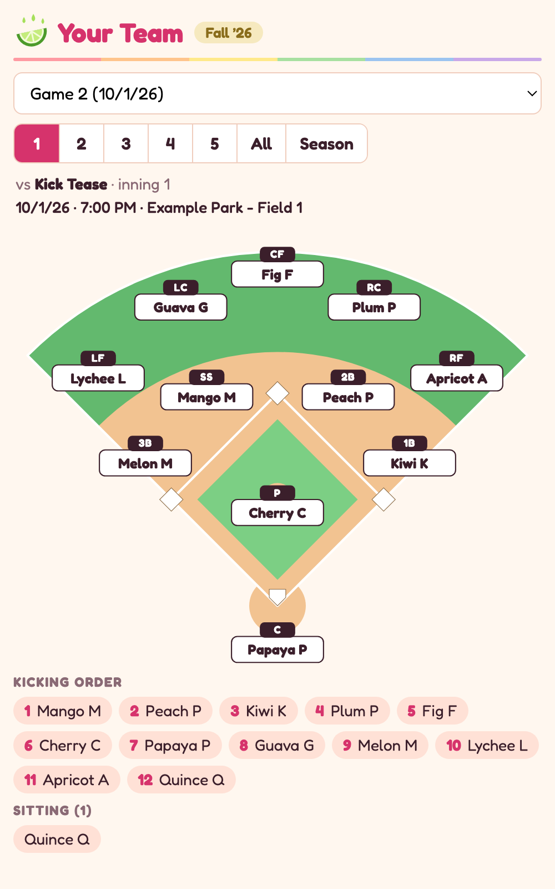
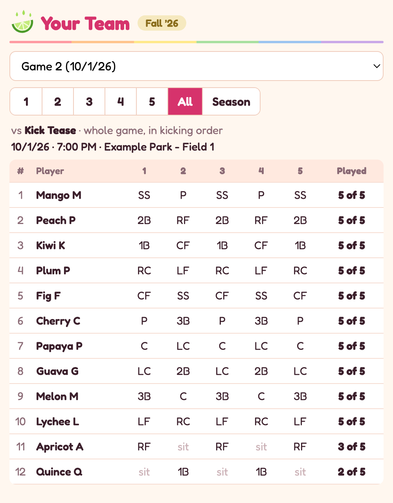
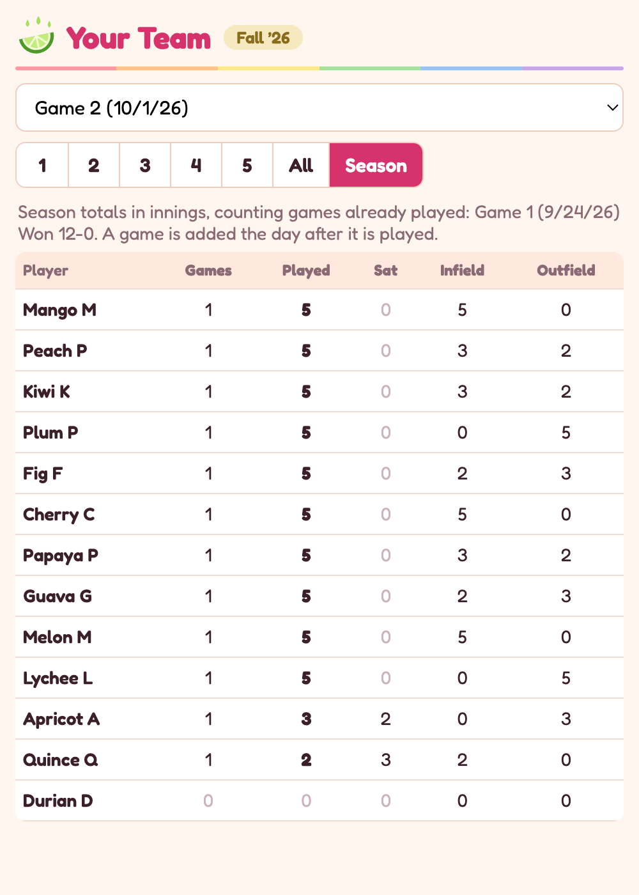

# Kickball Field View

A Google Apps Script add-on for a kickball lineup spreadsheet. It reads the lineup tabs and draws each inning's fielding on a diamond, with the kicking order, a whole-game table and season totals. It only writes to the `Comments` and `Field View Problems` tabs.

Screenshots use made-up players.

| Field | Whole game | Season |
| --- | --- | --- |
|  |  |  |

## Features

- Pick a game and an inning to see who plays each of the 11 positions
- Open or double-booked positions are flagged in red, and so is an absent player who still has a position
- Game date, time, location, opponent and final score
- Kicking order and the players sitting each inning
- Whole-game table with innings played per player
- Season totals: innings played, sat, infield and outfield, across games already played
- Refreshes every 3 seconds while open, so edits in the sheet show up on their own
- Shows load and update errors in a red box at the top, retries a failed first load on its own, and logs every error to a `Field View Problems` tab
- Works as a pop-up inside the sheet or as a shareable web app link that gives no access to the spreadsheet

## How the legacy app works

`apps-script/Code.gs` runs on Google's side and reads the sheet:

1. It adds the **Kickball** menu and opens the pop-up, or serves the page as a web app.
2. It finds the current lineup tabs.
3. On each tab it finds the player grid: the rows between "Name" and "Acceptable", and the columns with an inning number in the header.
4. For each player it returns the name, the position in each inning, and whether the name is struck through.
5. For each tab it also returns the date, time, location, opponent, and whether the game date has passed.

`apps-script/Field.html` is the page:

1. It asks `Code.gs` for all lineups once when it opens. After that, switching games or innings happens in the browser.
2. The field is an SVG with eleven fixed spots. For the selected inning it puts each player's name on the spot matching their position code.
3. The whole-game and season tables are built from the same data.
4. Every 3 seconds, while the page is visible, it re-asks for the selected tab and redraws only if something changed.

The script only writes to the `Comments` tab (suggestion box) and the `Field View Problems` tab (one row per error: time, where, message, details; repeats of the same error within 10 minutes are skipped). Both are created on first use. Deleting the two files from the Apps Script project removes the feature completely.

## Set up a team

1. Open the setup page (`start.html` on the site) and choose **Sign in with Google**.
2. Enter your team name and season, then choose **Create my team sheet**. To keep a sheet you already have, choose **Use a sheet I already have** and pick it. The app adds a `Team Config` tab to it.
3. Send the team link to your players.

You edit lineups in the sheet. The link refreshes by itself. Nothing is installed in the sheet and there is no script to paste or deploy.

The app asks Google for one permission, `drive.file`. It lets the app see only the sheet it created or the one you picked, never the rest of your Drive.

The `Team Config` tab has eight settings: team name, season label, icon, main color, second color, stripe (Blend or Rainbow), font and the suggestion box. The color cells take their fill color: click the box, then the paint bucket in the toolbar. White is a valid value. Everything else (page background, text, borders, highlights) is worked out from the two colors. The `Roster` and `Schedule` tabs feed the game tabs and are never sent to players.

## The team sheet

- `Schedule` holds each game's date, time, location, opponent and result once. A game tab looks its details up by the number in its `Game #:` cell.
- `Start here` is the first tab: setup steps and what the colors mean. It is never sent to players.
- To add the next game, duplicate the `New game (copy me)` tab, rename the copy so it ends with `Lineup`, and type its number in the `Game #:` cell. The blank tab is ignored until it is renamed.
- The lookup cells in a game tab show a red corner flag if someone types over their formula. The warning is a validation rule, so it carries over when a tab is duplicated.
- `Roster` holds each player's name, the positions they prefer and the positions they won't play, and private notes. Subs go on the roster like anyone else and are added to a game's grid when they play.
- In a game tab, the `RSVP` column takes Yes, Maybe or No as replies come in. A blank cell next to a name is gray, meaning no reply yet. Blank and Maybe players are still planned for, and a No turns the row gray.
- The `Prefers` and `Won't play` columns after the innings fill in from the roster. A preferred position turns green in the grid and a won't-play position turns red. These columns are never sent to players.
- The `Open spots` row under the grid lists the positions nobody is covering in each inning, and a position given to two players turns orange.

## How it works

1. `worker/` is a Cloudflare Worker. It holds an encrypted refresh token for each connected sheet and reads that one sheet through the Google Sheets API.
2. It returns only the lineup tabs (names ending in "Lineup", not starting with "OLD") and the `Team Config` settings. Roster notes, comments and every other tab stay in the sheet.
3. Reads are cached for 5 seconds, so many players refreshing do not each hit Google.
4. Suggestions from the page are appended to a `Comments` tab in the captain's sheet, limited to 60 per hour.
5. `site/` is the static page on GitHub Pages. `start.html` is the setup flow and `index.html?team=<code>` is the player view.
6. If the sheet is deleted, the Worker forgets the team and the link says so. The setup page drops the team from its list, and Stop sharing still works.
7. Team codes are random, so the link is the only thing protecting the lineup view. Anyone with the link can see the lineups, and nothing else.

### Running the Worker

```
cd worker
npm install
npm test
npx wrangler kv namespace create TEAMS
npx wrangler secret put GOOGLE_CLIENT_SECRET
npx wrangler secret put TOKEN_ENCRYPTION_KEY
npx wrangler deploy
```

`wrangler.toml` holds the KV namespace id, the Google client id and the allowed site origins. `TOKEN_ENCRYPTION_KEY` is 32 random bytes in base64. The Google project needs the Sheets, Drive and Picker APIs, a Web OAuth client and a Picker API key, all in `site/settings.js`.

## Legacy install (`apps-script/`)

The original single-team version, still in use. It keeps the page inside the Apps Script project instead of using the shared site.

1. In the spreadsheet, open **Extensions > Apps Script**.
2. Replace the contents of `Code.gs` with [`apps-script/Code.gs`](apps-script/Code.gs).
3. Add an HTML file named `Field` and paste in [`apps-script/Field.html`](apps-script/Field.html).
4. In **Project Settings > Script Properties**, add `TEAM_NAME` and `SEASON_LABEL`. They are the heading and the tag beside it.
5. Save and reload the spreadsheet, then use **Kickball > Field view**.

### Legacy sharing link

1. In the Apps Script editor, choose **Deploy > New deployment > Web app**.
2. Set **Execute as** to Me.
3. Set **Who has access** to Anyone, or Anyone with a Google account.
4. Send the link ending in `/exec`.

A link-holder sees every current lineup tab, the kicking order and the season totals, and nothing else from the spreadsheet. After changing the code, publish a new version with **Deploy > Manage deployments > edit > New version**, or the link keeps serving the old code.

## Automatic deploys

Pushing a change under `apps-script/` to `main` runs `.github/workflows/deploy.yml`, which uploads the files with [clasp](https://github.com/google/clasp) and moves the web app link to a new version. It overwrites the Apps Script project, so edits made in the online editor are lost on the next deploy.

It needs three repository secrets:

| Secret | Value |
| --- | --- |
| `CLASPRC_JSON` | Contents of `~/.clasprc.json` after `clasp login` |
| `SCRIPT_ID` | **Project Settings > IDs > Script ID** in the Apps Script editor |
| `DEPLOYMENT_ID` | The web app's ID from **Deploy > Manage deployments** |

The Apps Script API must be turned on at script.google.com/home/usersettings.

## What the sheet needs

| Convention | Used for |
| --- | --- |
| Tab name ends in "Lineup" | The tab is a game |
| Tab name starts with "OLD" | The tab is skipped |
| "Date:", "Time:", "Location:", "Opponent:", "Notes:", "Name" and "Open spots" (or "Acceptable") labels in column A | Finding the game details and the player grid. If one is missing, the view names the tab instead of guessing |
| "Game #:" label in column A with a number beside it | Names the game, like "Game 3 (10/21/26)", and puts the games in order. Two tabs cannot share a number: the later tab is hidden and a notice on the page names both tabs |
| Notes like "W, 12-0", "L, 3-5" or "T, 5-5" | Shown as "Won 12-0", "Lost 3-5" or "Tied 5-5". Other notes are shown as written |
| Inning numbers in the "Name" row | One column per inning |
| Position codes P, C, 1B, 2B, 3B, SS, LF, LC, CF, RC, RF | Placing players on the field. Any other code is flagged |
| "RSVP" in the Name row's column B, with Yes, Maybe or No beside each player | No means not attending. Blank (no reply yet) and Maybe count as playing |
| Strikethrough on a player's name | Player is not attending: left out of the kicking order, sitting list and totals |
| Row order of players | Kicking order |
| Game date before today | Game counts toward season totals |
| Same spelling of a name on every tab | Season totals add up as one person |

## Known limits

- The pop-up does not work in the Sheets phone app; the shared link does.
- A game counts toward season totals from the day after its date, whether or not it was actually played.
- Date and time appear exactly as the lineup tab displays them.
