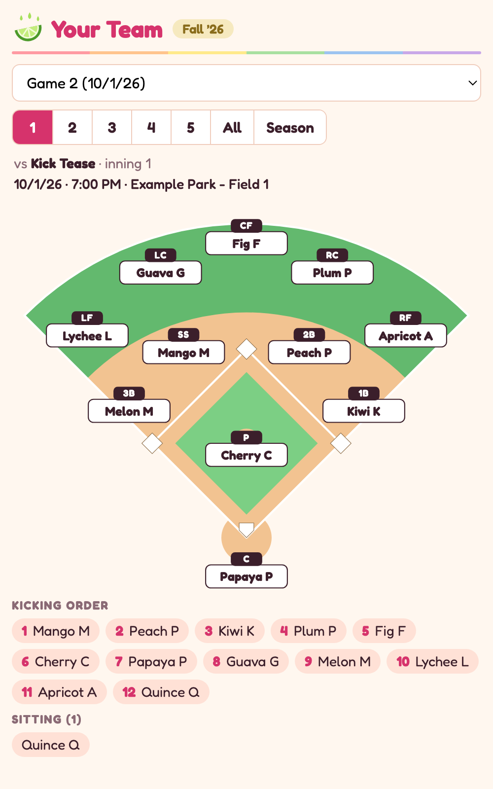
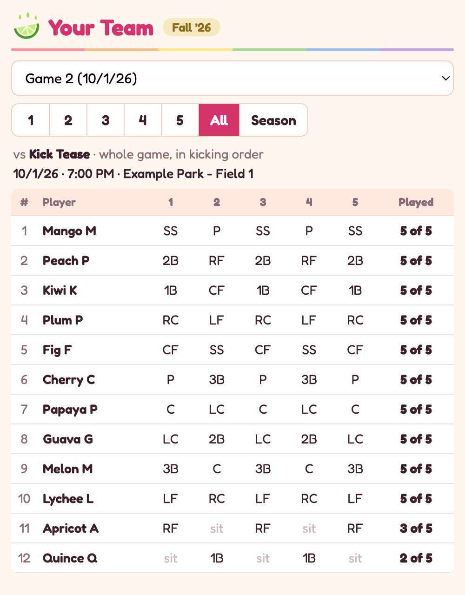
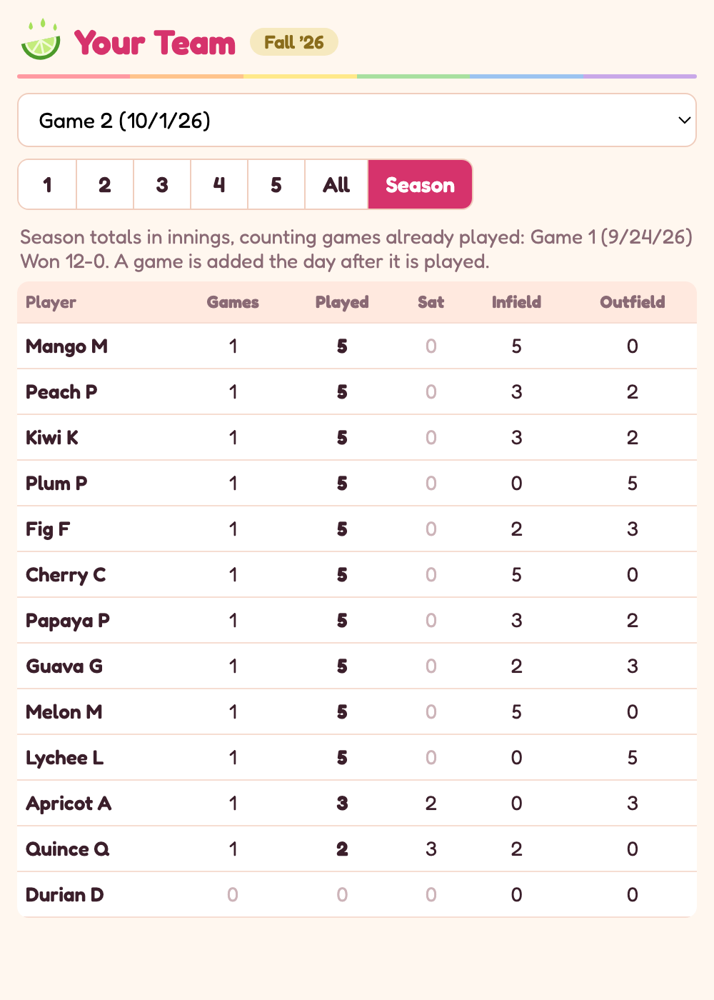

# Kickball Field View

A lineup page for a kickball team. The captain keeps the lineup in a Google Sheet, and players open one link on their phone to see who plays where in each inning, the kicking order, a whole-game table and season totals. Captains and co-captains can also edit the lineup from the same page. There is nothing to install.

It is free, needs no player accounts, and keeps all data in the captain's own Google Sheet. Most team apps cover scheduling and chat, or scoring, and the few that plan fielding are mostly paid.

Screenshots use made-up players.

| Field | Whole game | Season |
| --- | --- | --- |
|  |  |  |

## Features

- Pick a game and an inning to see who plays each of the 11 positions. The field shows a first name and last initial, like "Carl C.", adding letters when two players would match. A player who answered Maybe has a "?" after their name
- **Share lineup image** makes a picture of the whole game in team colors, like a screenshot of a lineup sheet: positions down the side, innings across, who sits each inning and the kicking order. It opens the share sheet where the device has one. **Save lineup image** downloads it instead
- Players see an unfilled position as a plain "open" chip. Lineup problems show only in Captain tools: a position given to two players is flagged in red, and so is an open position while someone is sitting
- Game date, time, location, opponent and final score
- Kicking order and the players sitting each inning, with the same short names as the field
- Whole-game table with innings played per player
- Season totals: innings played, sat, infield and outfield, across games already played
- Can be added to a phone's home screen. A team's page installs under the team's name with its main color, and opens straight to that team. Sharing the site's address shows a preview card
- Refreshes every 10 seconds while the page is in view, so edits in the sheet show up on their own, and shows when the lineup was last updated
- Shows load and update errors in a red box at the top, retries a failed first load on its own, and keeps the last good lineup on the device
- Captain tools: move players, reorder the kicking order, record RSVPs, add and remove players, edit the roster, enter results, set up the whole season and change the team's look, all from the team page

The site's [Help page](site/help.html) explains everything below in plain language for players and captains, and is linked from the team page, the Team tab and the setup page.

## Set up a team

1. Open the setup page (`start.html` on the site) and choose **Sign in with Google**.
2. Enter your team name and season, then choose **Create my team sheet**.
3. Choose **Open Captain tools** to add players and games, and send the team link to your players.

Players need no app, account or sign-in. Nothing is installed in the sheet and there is no script to paste or deploy. The app asks Google for one permission, `drive.file`. It lets the app see only the sheet it created, never the rest of your Drive.

## Captain tools

On the team page, **Edit** lets anyone who can edit the sheet change the lineup from their phone, so a game can be planned or adjusted without opening the Sheets app.

- **Who sees Edit:** The **Edit** button beside the team name is hidden from players. A captain or co-captain opens the team link once with `#captain` on the end, like `https://.../?team=abc123#captain`. After a successful sign-in the device remembers, and the button shows on its own. The setup page also lists a **Captain tools** link for each of your teams. Captain tools can't open by themselves from the link, because Google's sign-in window only opens from a tap.
- **Player view:** while editing, the same button reads **Player view** and shows the page exactly as players see it, without signing out. **Edit** goes back to where you were.
- **Signing in:** Sign in with Google and the page checks that your account can edit the team sheet. A co-captain who was shared the sheet picks it once in Google's file picker. Each visit starts with a Google sign-in, and the page keeps no sign-in afterward.
- **Lineup:** the field with the kicking order under it, the same as players see. Tap a position, then pick a player from the panel. They swap with whoever held the spot. After an open spot is filled, the panel moves to the next open one. To place a sitting player, tap them, then a position. In the kicking order, tap a kicker, then the kicker whose spot they should take. Each kicker's style from the roster shows beside their name. Everything is tap, then tap: there is no dragging. A player placed at a position they would rather not play gets an amber chip with a "!", and the player picker labels them "Rather not". Neither stops the move.
- **Copy to:** a change applies to the inning on screen. **Copy to** lists the other innings, and tapping one copies the inning on screen onto it, so a team that alternates can set 1 and copy it to 3 and 5, then set 2 and copy it to 4. An inning that already matches is grayed out.
- **RSVPs:** a headcount shows how many are playing (Yes and Maybe) and, once anyone has replied, warns below 8. **Mark … with no reply as Yes** answers everyone still blank in one step, for teams that don't collect replies. Set each player's RSVP to Yes, Maybe or No. No takes a player off the field and out of the kicking order, and keeps their positions in case they come back. The **×** removes them from this game. A name tapped under **Add from the roster** is marked Yes and goes after the last player, so late arrivals kick last.
- **Games:** every game on the `Schedule` tab. Each card shows the result once there is one, and before that how many have replied (like `6 yes · 1 ?`) once anyone has. Tap one to edit its date, time, location, opponent, **Label** (shown in place of "Game 7", like `Semifinal`) and **Result** (free text, like `Won 9-5`). Each field saves when you leave it, and Undo takes it back. Tapping a game also makes it the one Lineup and RSVPs show.
  - **Add a season** fills an empty schedule from a first date and a number of weekly games, and gives each one a lineup tab.
  - **Add a game** adds the next numbered game a week after the latest one, at the same time and place, with its lineup tab. Each tab starts with the whole roster and no replies. For a playoff, give it a **Label**.
  - **Archive** hides a game from players and from this list. Archived games are listed under **Archived** at the bottom, with **Unarchive**.
- **Copy lineup:** on a game whose field is still empty, **Copy lineup from Game N** brings over the positions and kicking order of the last game with a lineup, for everyone in both games.
- **Roster:** everyone on the `Roster` tab. Tap a name to change their name, preferred and won't-play positions, kicking style, pronouns or notes, or to remove them. Each change saves on its own, and Undo takes it back. **Add a player** starts with just a name, and the rest can be filled in after. **Add several** takes one name per line. Renaming a player renames them in every game. Removing someone asks first, and leaves them in games already set up.
- **Team:** the nine `Team Config` settings as a form. A sample line under Font shows the font you've picked. Each change saves on its own, and Undo takes it back. The team name can't be left empty. Copy buttons give the team link and the co-captain link, **Open the sheet** opens it in Google Sheets to share it with a co-captain, and the suggestion box setting links to the `Comments` tab.
- **Share:** the same lineup image as players get, from the bar beside Undo and Redo.
- **Undo and Redo:** Undo reverses the last saved change, and keeps going back through earlier ones. Redo puts back what Undo took away, until you make a new change. Undoing new lineup tabs deletes those tabs. Both last for the visit. The sheet's own version history keeps everything. Unsaved form changes are not on the list. **Reset** discards them.
- **Opening on the right game:** the team page opens on the next game by date, or the most recent one once the season is over.
- Edits are written to the sheet with your own account, so the sheet's version history shows who made them. If the sheet changed since the page last updated, nothing is saved and the page says so.

## Editing the sheet by hand

None of this is required. Captain tools does all of it, and the sheet is there if you prefer it.

The `Team Config` tab has nine settings, which a captain can also change from **Team** in Captain tools: team name, season label, icon, main color, second color, stripe (Blend, Solid, Split, Candy, pastel Rainbow, or Pride, Progress Pride, Trans, Bi, Lesbian and Nonbinary flag bands), stripe thickness (Thin or Thick), font (15 Google Fonts, loaded only when picked) and the suggestion box. A sheet made before Stripe thickness existed gets that row the first time it's changed from Captain tools. The color cells take their fill color: click the box, then the paint bucket in the toolbar. White is a valid value. Everything else (page background, text, borders, highlights) is worked out from the two colors. The `Roster` and `Schedule` tabs feed the game tabs and are never sent to players.

- `Schedule` holds each game's date, time, location, opponent, label and result once. A game tab looks its details up by the number in its `Game #:` cell. A playoff or makeup game can use text like `P1` in place of a number.
- `Start here` is the first tab. It holds the team link for players and the Captain link for you and any co-captain, as plain text to copy. A new sheet starts empty and hides the tabs the page manages (`Positions`, `Team Config` and `New game (copy me)`). View, then Hidden sheets, brings them back.
- To add games, use **Games** in Captain tools, or duplicate the `New game (copy me)` tab, rename the copy so it ends with `Lineup`, and type its number in the `Game #:` cell. A copy keeps the old number until you change it, and the page hides a tab whose number another tab already uses. The blank tab is ignored until it is renamed.
- The lookup cells in a game tab show a red corner flag if someone types over their formula. The warning is a validation rule, so it carries over when a tab is duplicated.
- `Roster` can be edited from **Roster** in Captain tools, and holds each player's name, the positions they prefer and the positions they won't play, private notes, a pronouns column and a Kicking column (Bunt, Power or Mixed). The Lineup tab in Captain tools shows each kicker's style beside their name. Subs go on the roster like anyone else and are added to a game's grid when they play.
- In a game tab, the `RSVP` column takes Yes, Maybe or No as replies come in. A blank cell next to a name is gray, meaning no reply yet. Only Yes and Maybe players are planned for: a player with no reply stays off the field and out of the kicking order until they answer, and a No turns the row gray.
- The `Prefers` and `Rather not` columns after the innings fill in from the roster. A preferred position turns green in the grid and a rather-not position turns red. These columns are never sent to players.
- The `Open spots` row under the grid lists the positions nobody is covering in each inning, and a position given to two players turns orange.

## How it works

1. `worker/` is a Cloudflare Worker. It holds an encrypted refresh token for each connected sheet and reads that one sheet through the Google Sheets API.
2. It returns only the lineup tabs (names ending in "lineup" in any capitalization), the `Schedule` tab's archive flags and the `Team Config` settings. Roster notes, comments and every other tab stay in the sheet.
3. Reads are cached for 15 seconds, and players loading at the same moment share one read of the sheet. After Captain tools adds, archives or removes a game, it asks the Worker for a fresh read with the captain's own Google sign-in, which the Worker accepts only from someone who can edit the sheet. That read also replaces the cached one. If Google limits reads, the page keeps showing the last good lineup with the time it was read, and the Worker waits a minute before asking again.
4. Suggestions from the page are appended to a `Comments` tab in the captain's sheet, limited to 60 per hour.
5. `site/` is the static page on GitHub Pages. `start.html` is the setup flow and `index.html?team=<code>` is the player view. Captain tools run in the browser and edit the sheet with the signed-in captain's own Google account, not through the Worker.
6. If the sheet is deleted or moved to the trash, the Worker forgets the team and the link says so. The setup page drops the team from its list, and Stop sharing still works.
7. Team codes are random, so the link is the only thing protecting the lineup view. Anyone with the link can see the lineups, and nothing else.
8. The team's sheet depends on the creator's Google connection. If it expires, the page shows a reconnect link for the captain who created the team.

### Running the Worker

```
cd worker
npm install
npm test
npx wrangler kv namespace create TEAMS
npx wrangler secret put GOOGLE_CLIENT_SECRET
npx wrangler secret put TOKEN_ENCRYPTION_KEY
npx wrangler deploy
```

`wrangler.toml` holds the KV namespace id, the Google client id and the allowed site origins. `TOKEN_ENCRYPTION_KEY` is 32 random bytes in base64. The Google project needs the Sheets, Drive and Picker APIs, a Web OAuth client and a Picker API key, all in `site/settings.js`.

Deploy the Worker before the site. The page asks for API version 9 and shows "out of date" against an older Worker.

A fork needs its own Worker URL, Google client id and Picker API key in `site/settings.js`, and its own origin in `ALLOWED_ORIGINS` in `wrangler.toml`.

## What the sheet needs

| Convention | Used for |
| --- | --- |
| Tab name ends in "Lineup" (any capitalization) | The tab is a game |
| Game # marked `Yes` in the `Schedule` tab's `Archived` column | The tab is skipped |
| "Name" and "Open spots" labels in column A, with "RSVP" beside "Name" | Finding the player grid. If one is missing, the view names the tab instead of guessing |
| "Date:", "Time:", "Location:", "Opponent:", "Label:" and "Result:" labels in column A, value in column B | Game details. Any that are missing show blank |
| "Game #:" label in column A with a number or text like P1 beside it | A number names the game, like "Game 3 (10/21/26)", and puts the games in order. Text like P1 matches the tab to its row on the `Schedule` tab. A game is named by its Label when it has one, and otherwise by its tab name. Two tabs cannot share a Game #: the later tab is hidden and a notice on the page names both tabs |
| Result text that contains W, L or T (or Won, Lost, Tied) and two scores, like "W, 12-0" or "Won 9-5" (your runs first) | The result of the game, shown as "Won 12-0" or "Lost 3-5". A game with a result counts toward season totals. Other text is shown as written |
| Inning numbers in the "Name" row | One column per inning |
| Position codes P, C, 1B, 2B, 3B, SS, LF, LC, CF, RC, RF | Placing players on the field. Any other code is flagged |
| Yes, Maybe or No in the RSVP column | Yes and Maybe count as playing. No and blank (no reply yet) are left out of the field, kicking order and totals. A game where nobody has said Yes or Maybe shows "The lineup isn't set yet" |
| Row order of players | Kicking order |
| Same spelling of a name on every tab | Season totals add up as one person |

## Known limits

- The field always has the 11 positions above, and the template has 5 innings.
- Each uncached sheet read uses two Google Sheets calls, and Google allows 300 read requests a minute per project, so the number of teams watched at the same moment is limited.
- Anyone with the team link sees the lineups and results. Stop sharing is the only way to revoke it.
- Players cannot reply to RSVPs themselves. The captain enters them.
- The page has no dark mode.
- A game counts toward season totals once its result is entered, so a rained-out game never counts.
- Date and time appear exactly as the lineup tab displays them.
- A sheet where positions run down the side and names fill the cells is not read. Players go in rows and positions are codes.

## License and contact

MIT, see [LICENSE](LICENSE). The hosted page's [terms](site/terms.html) and [privacy policy](site/privacy.html) are in `site/`. Report problems on [GitHub issues](https://github.com/Duncan-Wood/kickball/issues).
